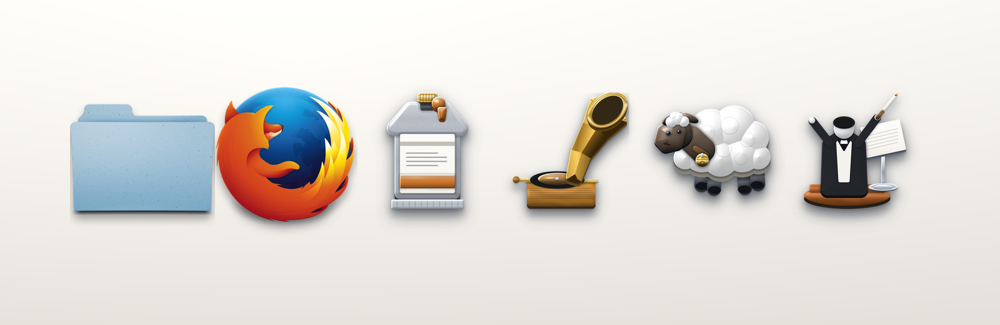

#+title: Skeu Icons
#+options: toc:2

A skeuomorphic icon theme for Linux desktops, plus the sources that produce it:
enamelled faces over chrome rims, glass key-caps, leather, paper, milled
aluminium — physical objects, not a squircle grid.

#+attr_html: :width 100% :alt six icons from the pack on a paper gradient

 1 223 icons across six freedesktop contexts, at 16, 22, 24, 32, 48, 64, 128,
  256 and 512 px, plus =@2x= HiDPI copies and a =scalable/= SVG layer —
  22 014 bitmaps and 1 083 vectors.

 File-type icons for 377 extensions, each under both its mime name and the
  =application-x-<ext>= fallback — see [[file:FILE-TYPES.org][FILE-TYPES.org]] for the scanned list.

 Two extra sets outside the theme: 164 icons for the applications installed
  here and 46 for personal projects.

 Every icon is its own object: no icon mask, no flat redesign, no uniform
  rounded-square grid.

Open [[file:gallery.html][gallery.html]] to see everything (it renders straight from the theme, no
server needed, with a size switcher and a light/dark/checker background).

* Install

#+begin_src sh
./install.sh                # every theme, into ~/.local/share/icons
./uninstall.sh              # remove them again
sudo ./install.sh --system  # /usr/share/icons
sudo ./uninstall.sh --system
#+end_src

One run installs thirty themes: the pack as drawn, =skeu-icons-dark= for dark
desktops, and an accent theme plus its dark sibling for each of the fourteen
enamels (red, orange, yellow, lime, green, teal, cyan, blue, indigo, violet,
magenta, pink, brown, graphite).

#+begin_src sh
skeu-icons                 the pack as drawn
skeu-icons-dark            same artwork, light-ink symbolic icons
skeu-icons-pink            pink enamel folders, everything else unchanged
skeu-icons-pink-dark       pink enamel, light-ink symbolic icons
#+end_src

Then pick one in your desktop's icon settings (GNOME Tweaks, XFCE Appearance,
KDE System Settings, …). Log out and back in if a launcher keeps its old icon.
The variants are symlink trees that inherit from =skeu-icons=, so the whole set
must live in the same directory; =uninstall.sh= removes exactly that set and
leaves other themes alone. For a single theme, the manual install is the same
idea:

#+begin_src sh
cp -a skeu-icons ~/.local/share/icons/
gtk-update-icon-cache -f -t ~/.local/share/icons/skeu-icons
#+end_src

** Colour and lightness variants

| theme                        | what it changes                                     |
|------------------------------+-----------------------------------------------------|
| =skeu-icons=                 | nothing: the pack as drawn                          |
| =skeu-icons-<accent>=        | folder artwork only, pointed at that enamel         |
| =skeu-icons-dark=            | symbolic ink only, from =#2e3436= to =#deddda=       |
| =skeu-icons-<accent>-dark=   | both                                                |

An accent theme is a few hundred relative symlinks, not another copy of the
artwork: =skeu-icons-pink/48x48/places/folder.png= is a link to
=folder-pink.png= in the base theme, and everything it does not override comes
through =Inherits=skeu-icons=. The light-ink symbolic layer is stored once, in
=skeu-icons-dark/symbolic=, and every =-dark= variant reaches it through one
relative directory link, so fourteen dark variants cost fourteen links instead
of fourteen copies of 646 files.

A toolkit recolours a =-symbolic= icon itself, which is why the ink matters
mostly to file managers, Qt applications and anything that renders one of those
SVGs as plain artwork.

* What it looks like

** Applications

Thirty-two of the 164 application icons: a chrome-rimmed folder, browsers and
editors that keep their own marks, and the objects invented for the GTK/GNOME
apps — a gramophone for Amberol, a cassette for Riff, a tuning fork, an
oscilloscope, a prism, a paint tube, a fountain-pen nib, a horseshoe magnet, a
pallet, glass cubes, a screen with a keyboard for VNC, a moored mine for Mines,
a pencil pad for Sudoku.

#+attr_html: :width 100% :alt app icons: files, browsers, editors, media, games, tools
[[file:docs/apps.png]]

** Projects

The 46 project icons: a sheep for lambdock, a black widow for araneola, a padlock
for bewaking, Lady Justice for veritas, a conductor for wikimusic, a chart
recorder for symbanta, a gnu for guix, a snowflake for nixpkgs, an anchor for
carvoeiro-water-fun.

#+attr_html: :width 100% :alt project icons
[[file:docs/projects.png]]

** Contexts

The theme proper: category medallions, place folders (14 colour variants),
drives, phones, printers and network gear.

#+attr_html: :width 100% :alt categories, places and devices from the theme
[[file:docs/contexts.png]]

* What's in the box

| path                  | what it is                                                    |
|-----------------------+---------------------------------------------------------------|
| =skeu-icons/=         | the theme: 16…512 px + =@2x= + =scalable/=, =index.theme=     |
| =gallery.html=        | single-file preview: every icon, every size, size switcher    |
| =theme-manifest.json= | audit trail: shipped names, contexts, sizes, palette          |
| =FILE-TYPES.org=      | every extension found in =$HOME=, its icon and file count     |
| =app-icons/=          | 164 icons for installed GUI apps (PNG 16→1024)                |
| =project-icons/=      | 46 icons for project folders (same sizes)                     |
| =generated/=          | 1024 px masters for categories and devices                    |
| =svg/=                | hand-drawn vector sources (1024×1024, real paths)             |
| =docs/=               | the sheets this README shows, composed by =tools/make_doc_images.py= |
| =tools/=              | the programmes that draw the artwork                          |
| =maak.scm=            | the tasks that redraw and re-derive everything                |
| =install.sh=          | user/system installer with cache refresh                      |
| =uninstall.sh=        | removes the installed themes and refreshes the cache          |

=app-icons/= and =project-icons/= are not part of the theme; copy one onto a
launcher or a folder when you want that specific item to match.

* Theme structure

The theme follows the same layout conventions as Adwaita, so desktop tooling
that knows one knows the other:

| convention            | here                                                          |
|-----------------------+---------------------------------------------------------------|
| directories           | =<N>x<N>/<context>=, one section per directory in =index.theme= |
| contexts              | =apps=, =places=, =mimetypes=, =emblems=, =categories=, =devices= |
| =Context= values      | =Applications=, =Places=, =MimeTypes=, =Emblems=, =Categories=, =Devices= |
| raster sections       | =Size=<N>=, =Context=…, =Type=Fixed=                          |
| HiDPI                 | =<N>x<N>@2x=< trees declared in =ScaledDirectories= with =Scale=2= |
| scalable layer        | =scalable/<context>=, =Size=128=, =MinSize=8=, =MaxSize=512=, =Type=Scalable= |
| header                | =Example=folder=, =Inherits=AdwaitaLegacy,hicolor=, =DisplayDepth=32= |
| KDE overlays          | =LinkOverlay=emblem-symbolic-link=, =LockOverlay=emblem-readonly= |

Two of those are worth spelling out. The inheritance chain lists
=AdwaitaLegacy= before =hicolor= exactly as Adwaita itself does, so any name
this pack still does not draw resolves to the GNOME legacy set when it is
installed, and to =hicolor= otherwise; the pack's own =symbolic/= and
=scalable/= layers are found first, in the theme directory itself. And the sizes go
further than Adwaita's raster set (8–48 px): 64, 128, 256 and 512 px plus the
=@2x= trees are shipped as real bitmaps rather than left to the scalable
layer, which is safest for launchers, docks and file managers that upscale
badly.

* Drawing the artwork

There is no build system: the icons are committed, and the drawing tools are
plain Python programmes you run when you want to redraw a set. =maak.scm= puts
the ones you will actually want behind named tasks:

#+begin_src sh
maak --list           # every task with its docstring
maak gallery          # rebuild gallery.html from the icons on disk
maak docs             # recompose the sheets in docs/ for this README
maak build            # gallery + docs, then verify
maak check            # index.theme, every directory, counts, gallery freshness
maak icons apps       # redraw the artwork (categories/devices/projects, then apps)
maak symbolic         # redraw the 646 symbolic icons + 487 plain scalable ones
maak variants         # rebuild the accent and dark variant themes
maak report           # rescan $HOME -> FILE-TYPES.org
maak install          # ~/.local/share/icons, with cache refresh
maak uninstall        # remove them again
#+end_src

Each task simply runs one script, so the scripts work on their own too:

#+begin_src sh
python3 tools/render_skeu.py          # categories + devices + project icons
python3 tools/make_app_icons.py       # app-icons/ for the apps installed here
python3 tools/make_context_icons.py   # just the category and device masters
python3 tools/make_gallery.py         # gallery.html (add --check to test freshness)
python3 tools/make_doc_images.py      # docs/ sheets for this README
python3 tools/make_alt_icons.py       # the Alt material variants -> svg/
python3 tools/make_symbolic.py        # the symbolic layer (646 names)
python3 tools/make_plain.py           # the un-suffixed scalable icons (487)
python3 tools/make_variants.py        # the accent and dark variant themes
python3 tools/report_file_types.py    # rescan $HOME -> FILE-TYPES.org
python3 tools/check_theme.py          # the checks behind maak check
#+end_src

=make_symbolic.py= writes one Aqua glyph per Adwaita symbol name, checked against
=tools/symbolic-names.txt=; =make_plain.py= draws the same glyphs without the
=-symbolic= suffix for the contexts that had no artwork at all, so a toolkit
asking for =list-add= gets an answer instead of falling through to AdwaitaLegacy
or to nothing.

=render_skeu.py= writes the 1024 px masters into =generated/= and a full PNG set
per project; =make_app_icons.py= discovers the installed applications from their
desktop entries, so the set follows the machine. =make_gallery.py= reads the
theme directories and both =index.json= files, so a new icon shows up in the
gallery after one run - =--check= is what =maak check= uses to catch a stale
=gallery.html=. The relief renderer itself lives in =tools/skeu/= (numpy +
Pillow; =inkscape= for the handful of vector icons).

* Coverage

| context      | icons | notes                                                   |
|--------------+------:+---------------------------------------------------------|
| =apps=       |   322 | the full app set plus the hand-drawn icons              |
| =places=     |   171 | folders, drives, network shares, 14 colour variants     |
| =mimetypes=  |   618 | documents, media, archives, source code, 377 extensions |
| =emblems=    |    17 | read-only, symbolic links, locked, shared …             |
| =categories= |    27 | menu and application-group icons                        |
| =devices=    |    88 | drives, phones, printers, USB, network hardware          |

Those six contexts ship as relief bitmaps. Everything else Adwaita names is
covered too, drawn rather than modelled:

| layer                        | icons | what it is                                     |
|------------------------------+------:+------------------------------------------------|
| =symbolic/<context>=         |   646 | one Aqua glyph per Adwaita =-symbolic= name      |
| =scalable/actions=           |   182 | the same glyphs without the suffix               |
| =scalable/status=            |   237 | volume, network, battery, security, accounts      |
| =scalable/emotes=            |    26 | the Aqua faces                                   |
| =scalable/ui=, =legacy=      |    77 | window widgets and Adwaita compatibility names   |

=actions=, =status=, =emotes= and =ui= used to fall through to AdwaitaLegacy
because the pack drew no artwork for them. They are the one place where a
monochrome drawing is the right answer: a toolbar button is not an object, and
inventing a skeuomorphic sculpture for "undo" would break the illusion faster
than a clean glyph does. =devices= is complete: every device name Adwaita ships
now has a drawn object, from an AC brick and a candybar phone to a colour meter,
a smart card and a Thunderbolt dock.

* Artwork policy

* Neutral body, one accent: metal, glass, paper, leather or wood with a single
  coloured gem or enamel detail covering roughly a tenth of the icon.
* One key light from the upper left, contact shadows where parts meet, and a
  soft cast shadow that fades before the canvas edge.
* No monograms on coloured plates, no icon mask, no hairline detail — every
  line is at least 3 px wide at 1024 px so it survives 32 px.
* Apps get the object that matches their job: a terminal is a CRT shell, a
  browser a steel desk globe, a mail client an envelope with a wax seal.
  Related apps only share an object when the job is the same — 14 editors share
  a key-cap family, but the seven music players do not share one sleeve.
  See [[file:CUSTOM-ICONS.md][CUSTOM-ICONS.md]] for the rules and the measurements,
  [[file:ICON-PROMPT.md][ICON-PROMPT.md]] for the drawing brief, and
  [[file:app-icons/README.md][app-icons/README.md]] for the per-app object table.

* Licence

The artwork (=skeu-icons/=, =svg/=, =generated/=, =app-icons/=, =project-icons/=)
and the scripts that draw it are released under the *Creative Commons
Attribution-ShareAlike 4.0 International* licence — see [[file:LICENSE][LICENSE]].

You are free to share and adapt them, including commercially, as long as you
credit *Skeu Icons* and keep derivative packs under the same licence.

Application names and their marks belong to their owners and are used only to
describe which icon is which; a handful of icons in =svg/= reproduce marks that
stay under their own licences (the credits are listed at the end of
[[file:CUSTOM-ICONS.md][CUSTOM-ICONS.md]]).
