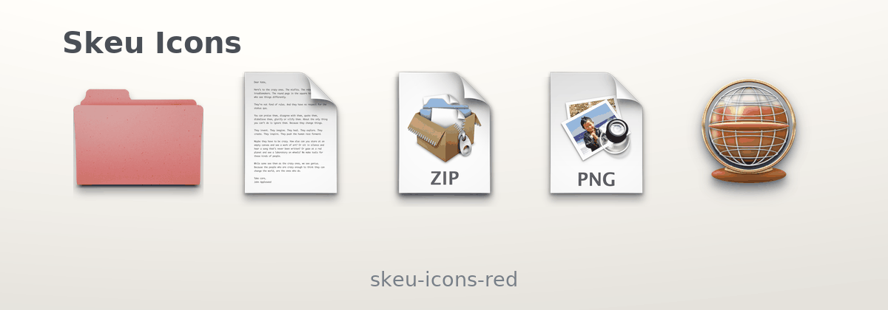
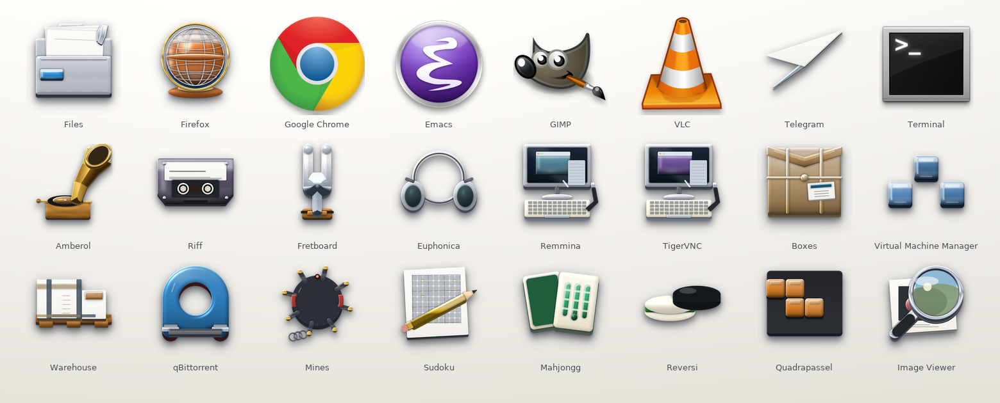
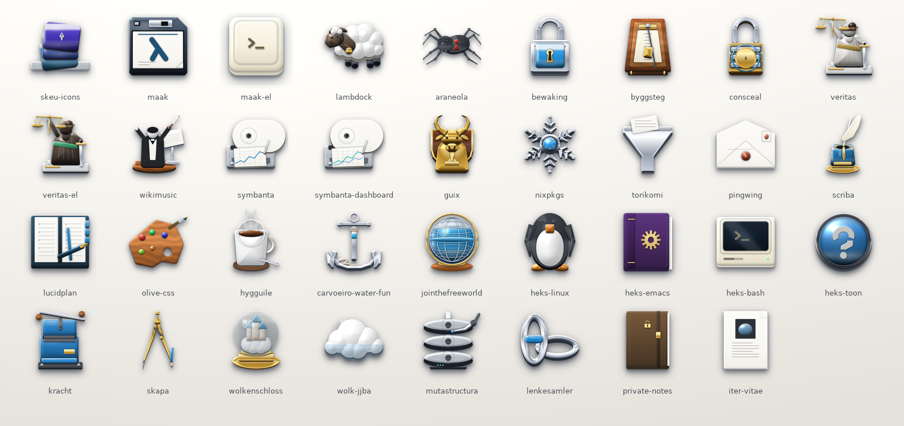
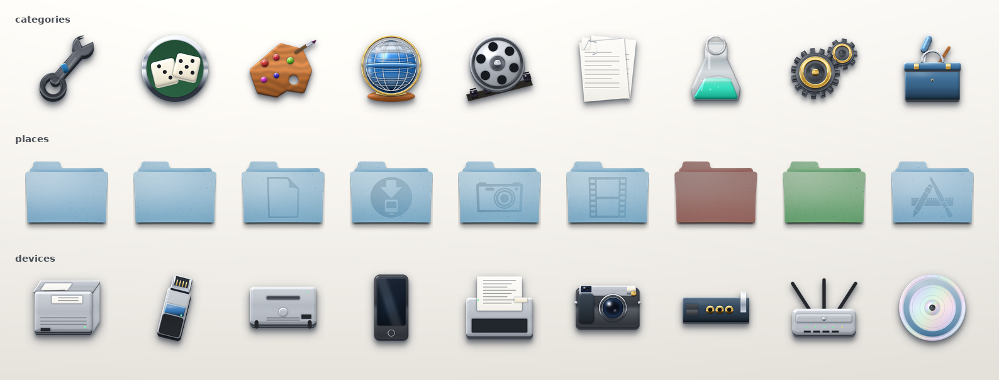

#+title: Skeu Icons
#+subtitle: an icon theme where every icon is a painted object
#+author: Josep Bigorra
#+email: jjbigorra@gmail.com
#+language: en
#+options: toc:2 num:nil
#+html_head: <meta name="description" content="A skeuomorphic icon theme for Linux desktops: 1 914 icon names across six freedesktop contexts, thirty themes, symbolic and accent variants." />

[[https://codeberg.org/jjba23/skeu-icons][https://img.shields.io/badge/source-Codeberg-2185d0.svg]]
[[https://codeberg.org/jjba23/skeu-icons/src/branch/trunk/LICENSE][https://img.shields.io/badge/licence-CC--BY--SA--4.0-f5c542.svg]]
[[https://codeberg.org/jjba23/skeu-icons/src/branch/trunk/gallery.html][https://img.shields.io/badge/gallery-every%20icon-8a6d3b.svg]]
[[https://codeberg.org/jjba23/guix-jointhefreeworld][https://img.shields.io/badge/Guix-channel-6f4e9c.svg]]
[[https://codeberg.org/jjba23/nix-jointhefreeworld][https://img.shields.io/badge/Nix-flake-5277c3.svg]]
[[https://codeberg.org/jjba23/skeu-icons][https://img.shields.io/badge/icons-1%20914-informational.svg]]
[[https://codeberg.org/jjba23/skeu-icons][https://img.shields.io/badge/themes-30-informational.svg]]

A skeuomorphic icon theme for Linux desktops, plus the sources that produce it:
enamelled faces over chrome rims, glass key-caps, leather, paper, milled
aluminium — physical objects, not a squircle grid.

#+caption: One row, fourteen enamels. Every theme is the same pack with a different folder colour.
#+attr_html: :width 100% :alt the folder enamel changing from red through graphite, beside a document, an archive, an image and Firefox

If you have five seconds: this is an icon theme that draws a folder as a folder,
a printer as a printer and a cassette as a cassette, and it ships thirty versions
of itself — the pack as drawn, a dark sibling, and an accent theme for each of
fourteen enamels.

- *Who it is for*: desktop users on GNOME, KDE, XFCE, Cinnamon, MATE or LXQt who
  are tired of everything looking like the same rounded square.
- *How to get it*: [[#quick-start][one script]], =guix install skeu-icons=, or the Nix
  flake — all three take about a minute.
- *What it costs*: nothing at runtime; the artwork is CC BY-SA 4.0, free to use,
  share and adapt.

* Why you'll want it

- *Objects, not masks.*  No icon mask, no uniform rounded-square grid, no flat
  redesign: each icon is built from material, light and a little story. The
  terminal is a CRT shell, the browser a steel desk globe, the mail client an
  envelope with a wax seal.
- *Complete, not curated.*  1 914 icon names across all six freedesktop
  contexts, at nine sizes plus =@2x= and a =scalable/= layer. It is a drop-in
  replacement, not a set of showcase folders.
- *Thirty themes from one install.*  Pick an enamel (red, orange, yellow, lime,
  green, teal, cyan, blue, indigo, violet, magenta, pink, brown, graphite), light
  or dark ink, and change your mind whenever you like: the variants are symlink
  trees, not thirty copies of the artwork.
- *Names that actually resolve.*  Docks ask for desktop ids, window classes and
  =Icon= values; file managers ask GIO for a MIME chain. The pack links all of
  them, and [[#drawing-and-checking-the-artwork][a check]] proves it against your
  own installed programs instead of trusting a table.
- *Monochrome where monochrome belongs.*  A 646-name symbolic layer for the
  Adwaita contract, plus 487 plain scalable icons so that a toolbar asking for
  =list-add= gets an answer instead of falling through to =AdwaitaLegacy=.
- *Real bitmaps at real sizes.*  16, 22, 24, 32, 48, 64, 128, 256 and 512 px are
  shipped as PNGs (with =@2x= twins), because launchers and docks that upscale a
  48 px icon look worse than they need to.
- *In your package manager.*  Packaged for
  [[https://codeberg.org/jjba23/guix-jointhefreeworld][the Guix channel]] and
  [[https://codeberg.org/jjba23/nix-jointhefreeworld][the Nix flake]] that carry
  the rest of this collection.
- *Nothing hidden.*  The themes are committed artwork; the programmes that draw
  and check them are in the repository, and one command re-derives everything.

* Quick start
:PROPERTIES:
:CUSTOM_ID: quick-start
:END:

** 1. Install the themes

#+begin_src sh
git clone https://codeberg.org/jjba23/skeu-icons.git
cd skeu-icons
./install.sh
#+end_src

That is the whole installation for your user (~/.local/share/icons). For every
user on the machine:

#+begin_src sh
sudo ./install.sh --system      # /usr/share/icons
#+end_src

** 2. Pick it in your desktop

Choose *Skeu Icons* in your icon settings — GNOME Tweaks → Appearance → Icons,
XFCE Appearance → Icons, KDE System Settings → Appearance → Icons, or the
equivalent in Cinnamon, MATE and LXQt. From a terminal:

#+begin_src sh
# GNOME, Cinnamon, MATE (and anything using the GNOME settings daemon)
gsettings set org.gnome.desktop.interface icon-theme 'skeu-icons'

# XFCE
xfconf-query -c xsettings -p /Net/IconThemeName -s skeu-icons

# KDE Plasma 6 (use kwriteconfig5 on Plasma 5)
kwriteconfig6 --file kdeglobals --group Icons --key Theme skeu-icons   # log out after
#+end_src

Prefer a different enamel? Substitute =skeu-icons-pink=, =skeu-icons-teal-dark=,
or any of [[#the-thirty-themes][the thirty names]].

** 3. See it working

#+begin_src sh
ls ~/.local/share/icons/skeu-icons/index.theme   # the theme is where the toolkits look
xdg-open gallery.html                            # every icon, every size, no server
#+end_src

If an open window keeps its old icon, log out and back in: launchers cache the
icon they started with.

** Uninstall

#+begin_src sh
./uninstall.sh                 # or: sudo ./uninstall.sh --system
#+end_src

It removes exactly the thirty themes this pack installs and leaves every other
theme alone.

* Install options

** The installer

#+begin_src sh
./install.sh                  # every theme, for the current user
./install.sh --dry-run        # show what would happen, change nothing
sudo ./install.sh --system    # /usr/share/icons, for every user
./install.sh --uninstall      # same as ./uninstall.sh
./install.sh --help           # the options, briefly
#+end_src

It copies the themes, then refreshes the icon cache with
=gtk-update-icon-cache= or =gtk4-update-icon-cache= and rebuilds the KDE service
database with =kbuildsycoca= when those tools are present. Nothing needs to be
compiled and nothing runs in the background.

** Guix

=skeu-icons= is packaged in the
[[https://codeberg.org/jjba23/guix-jointhefreeworld][guix-jointhefreeworld
channel]] (module =(jointhefreeworld packages misc)=). Add the channel to
=~/.config/guix/channels.scm= following that repository's README, then:

#+begin_src sh
guix pull
guix install skeu-icons
#+end_src

It installs the thirty themes under =share/icons=; the profile hook writes
=icon-theme.cache= when GTK is in the same profile. To build it from a checkout
of the channel instead:

#+begin_src sh
guix build -L channel skeu-icons
#+end_src

** Nix

The themes are a package of the
[[https://codeberg.org/jjba23/nix-jointhefreeworld][nix-jointhefreeworld]] flake:

#+begin_src sh
nix profile install git+https://codeberg.org/jjba23/nix-jointhefreeworld#skeu-icons
#+end_src

On NixOS or with Home Manager, use the overlay so the name is the one nixpkgs
would use:

#+begin_src nix
{
  inputs.nix-jointhefreeworld.url = "git+https://codeberg.org/jjba23/nix-jointhefreeworld";

  # in the module that builds the system:
  nixpkgs.overlays = [ inputs.nix-jointhefreeworld.overlays.default ];
  environment.systemPackages = [ pkgs.skeu-icons ];
}
#+end_src

Then select =skeu-icons= (or an accent) in the desktop's icon settings as usual.

** Manual copy

The variants inherit from the base theme, so the whole set has to sit in the same
directory:

#+begin_src sh
cp -a skeu-icons* ~/.local/share/icons/
gtk-update-icon-cache -f -t ~/.local/share/icons/skeu-icons
#+end_src

** Requirements

| what                                     | why                                                    |
|------------------------------------------+--------------------------------------------------------|
| a freedesktop desktop                    | GNOME, KDE, XFCE, Cinnamon, MATE, LXQt, sway/niri bars |
| =bash=                                   | only for =install.sh=; the themes need nothing         |
| =gtk-update-icon-cache=, =kbuildsycoca=  | optional; refresh the cache after installing           |
| =python3=, =numpy=, =Pillow=, =inkscape= | only to redraw the artwork                             |

A desktop is the only real requirement: the themes are static files, and the
other tools are for convenience. For the drawing side, see
[[#drawing-and-checking-the-artwork][Drawing and checking the artwork]].

* The thirty themes
:PROPERTIES:
:CUSTOM_ID: the-thirty-themes
:END:

One run installs the pack in every form it ships — the names below are what
you will find in your icon directory afterwards:

#+begin_example
skeu-icons                  the pack as drawn
skeu-icons-dark             same artwork, light-ink symbolic icons
skeu-icons-<accent>         folder artwork only, pointed at that enamel
skeu-icons-<accent>-dark    both
#+end_example

| theme                        | what it changes                                     |
|------------------------------+-----------------------------------------------------|
| =skeu-icons=                 | nothing: the pack as drawn                          |
| =skeu-icons-<accent>=        | folder artwork only, pointed at that enamel         |
| =skeu-icons-dark=            | symbolic ink only, from =#2e3436= to =#deddda=       |
| =skeu-icons-<accent>-dark=   | both                                                |

The fourteen enamels are red, orange, yellow, lime, green, teal, cyan, blue,
indigo, violet, magenta, pink, brown and graphite.

An accent theme is a few hundred relative symlinks, not another copy of the
artwork: =skeu-icons-pink/48x48/places/folder.png= is a link to
=folder-pink.png= in the base theme, and everything it does not override comes
through =Inherits=skeu-icons=. The light-ink symbolic layer is stored once, in
=skeu-icons-dark/symbolic=, and every =-dark= variant reaches it through one
relative directory link, so fourteen dark variants cost fourteen links instead
of fourteen copies of 646 files.

A toolkit recolours a =-symbolic= icon itself, which is why the ink matters
mostly to file managers, Qt applications and anything that renders one of those
SVGs as plain artwork.

* What it looks like

** Applications

Twenty-four of the 251 application icons: a chrome-rimmed paper stack for Files,
browsers and editors that keep their own marks, and the objects invented for the
GTK/GNOME apps — a gramophone for Amberol, a cassette for Riff, a tuning fork
for Fretboard, headphones for Euphonica, a screen with a keyboard for both VNC
clients, a cardboard box for Boxes, glass cubes for the virtual machine manager,
a moored mine for Mines, a pencil pad for Sudoku, and the Mahjongg tiles and
Reversi stones.

#+attr_html: :width 100% :alt app icons: files, browsers, editors, media, games, tools

** Projects

A selection of the 46 project icons: a sheep for lambdock, a black widow for
araneola, a padlock for bewaking, Lady Justice for veritas, a conductor for
wikimusic, a chart recorder for symbanta, a gnu for guix, a snowflake for
nixpkgs, an anchor for carvoeiro-water-fun.

#+attr_html: :width 100% :alt project icons

** Contexts

The theme proper: category medallions, place folders (14 colour variants),
drives, phones, printers and network gear.

#+attr_html: :width 100% :alt categories, places and devices from the theme

* What's inside

| context      | icons | notes                                                   |
|--------------+------:+---------------------------------------------------------|
| =apps=       |   933 | 251 drawn icons, each linked under every name it is asked by |
| =places=     |   171 | folders, drives, network shares, 14 colour variants     |
| =mimetypes=  |   678 | documents, media, archives, source code, 377 extensions |
| =emblems=    |    17 | read-only, symbolic links, locked, shared …             |
| =categories= |    27 | menu and application-group icons                        |
| =devices=    |    88 | drives, phones, printers, USB, network hardware           |

That is 1 914 names, shipped at 16, 22, 24, 32, 48, 64, 128, 256 and 512 px with
=@2x= twins, plus the =scalable/= SVGs — 128 directories declared in
=index.theme=. File-type icons cover 377 extensions, each under both its MIME
name and the =application-x-<ext>= fallback; =maak report= rescans =$HOME= and
writes the list to =FILE-TYPES.org= when you want to see what your own machine
asks for.

Every name a toolkit can ask for is present, including the family generics
(=package-x-generic=, =text-x-generic-template=, =x-content-x-generic= …) that
GIO falls back to when a specific type has no art of its own.

Those six contexts ship as relief bitmaps. Everything else Adwaita names is
covered too, drawn rather than modelled:

| layer                        | icons | what it is                                     |
|------------------------------+------:+------------------------------------------------|
| =symbolic/<context>=         |   646 | one Aqua glyph per Adwaita =-symbolic= name      |
| =scalable/actions=           |   166 | the same glyphs without the suffix               |
| =scalable/status=            |   218 | volume, network, battery, security, accounts      |
| =scalable/emotes=            |    26 | the Aqua faces                                   |
| =scalable/ui=, =legacy=      |    77 | window widgets and Adwaita compatibility names   |

=actions=, =status=, =emotes= and =ui= used to fall through to AdwaitaLegacy
because the pack drew no artwork for them. They are the one place where a
monochrome drawing is the right answer: a toolbar button is not an object, and
inventing a skeuomorphic sculpture for "undo" would break the illusion faster
than a clean glyph does. =devices= is complete: every device name Adwaita ships
now has a drawn object, from an AC brick and a candybar phone to a colour meter,
a smart card and a Thunderbolt dock.

Open [[file:gallery.html][gallery.html]] to see everything (it renders straight from the theme, no
server needed, with a size switcher and a light/dark/checker background).

* Theme structure

The theme follows the same layout conventions as Adwaita, so desktop tooling
that knows one knows the other:

| convention            | here                                                          |
|-----------------------+---------------------------------------------------------------|
| directories           | =<N>x<N>/<context>=, one section per directory in =index.theme= |
| contexts              | =apps=, =places=, =mimetypes=, =emblems=, =categories=, =devices= |
| =Context= values      | =Applications=, =Places=, =MimeTypes=, =Emblems=, =Categories=, =Devices= |
| raster sections       | =Size=<N>=, =Context=…, =Type=Fixed=                          |
| HiDPI                 | =<N>x<N>@2x=< trees declared in =ScaledDirectories= with =Scale=2= |
| scalable layer        | =scalable/<context>=, =Size=128=, =MinSize=8=, =MaxSize=512=, =Type=Scalable= |
| header                | =Example=folder=, =Inherits=AdwaitaLegacy,hicolor=, =DisplayDepth=32= |
| KDE overlays          | =LinkOverlay=emblem-symbolic-link=, =LockOverlay=emblem-readonly= |

Two of those are worth spelling out. The inheritance chain lists
=AdwaitaLegacy= before =hicolor= exactly as Adwaita itself does, so any name
this pack still does not draw resolves to the GNOME legacy set when it is
installed, and to =hicolor= otherwise; the pack's own =symbolic/= and
=scalable/= layers are found first, in the theme directory itself. And the sizes go
further than Adwaita's raster set (8–48 px): 64, 128, 256 and 512 px plus the
=@2x= trees are shipped as real bitmaps rather than left to the scalable
layer, which is safest for launchers, docks and file managers that upscale
badly.

* Where everything lives

| path                  | what it is                                                    |
|-----------------------+---------------------------------------------------------------|
| =skeu-icons/=         | the theme: 16…512 px + =@2x= + =scalable/=, =index.theme=     |
| =gallery.html=        | single-file preview: every icon, every size, size switcher    |
| =theme-manifest.json= | audit trail: shipped names, contexts, sizes, palette          |
| =app-icons/=          | 251 GUI app icons — installed here plus the roster (PNG 16→1024) |
| =project-icons/=      | 46 icons for project folders (same sizes)                     |
| =generated/=          | 1024 px masters for categories and devices                    |
| =svg/=                | hand-drawn vector sources (1024×1024, real paths)             |
| =docs/=               | the sheets and the demo this README shows                     |
| =tools/=              | the programmes that draw the artwork                          |
| =maak.scm=            | the tasks that redraw and re-derive everything                |
| =install.sh=          | user/system installer with cache refresh                      |
| =uninstall.sh=        | removes the installed themes and refreshes the cache          |

=app-icons/= and =project-icons/= are not part of the theme; copy one onto a
launcher or a folder when you want that specific item to match. Two extra sets
live there: 164 icons for the applications installed here and 46 for personal
projects.

* Drawing and checking the artwork
:PROPERTIES:
:CUSTOM_ID: drawing-and-checking-the-artwork
:END:

There is no build system: the icons are committed, and the drawing tools are
plain Python programmes you run when you want to redraw a set. =maak.scm= puts
the ones you will actually want behind named tasks:

#+begin_src sh
maak --list           # every task with its docstring
maak gallery          # rebuild gallery.html from the icons on disk
maak docs             # recompose the sheets and the demo in docs/
maak counts           # rewrite the counts this README quotes from the theme
maak build            # gallery + docs + counts, then verify
maak check            # index.theme, every directory, counts, gallery freshness
maak icons apps       # redraw the artwork (categories/devices/projects, then apps)
maak names            # link the app names and file-type names the desktops ask for
maak mappings         # ask GIO which icon real files and desktop entries get
maak symbolic         # redraw the 646 symbolic icons + 487 plain scalable ones
maak variants         # rebuild the accent and dark variant themes
maak report           # rescan $HOME -> FILE-TYPES.org
maak install          # ~/.local/share/icons, with cache refresh
maak uninstall        # remove them again
#+end_src

Each task simply runs one script, so the scripts work on their own too:

#+begin_src sh
python3 tools/render_skeu.py          # categories + devices + project icons
python3 tools/make_app_icons.py       # app-icons/ for the apps installed here
python3 tools/make_theme_apps.py      # every app name a desktop asks for
python3 tools/make_theme_mimes.py     # mimetype generics + near-miss aliases
python3 tools/make_context_icons.py   # just the category and device masters
python3 tools/make_gallery.py         # gallery.html (add --check to test freshness)
python3 tools/make_doc_images.py      # docs/ sheets for this README
python3 tools/make_demo_gif.py        # docs/demo.gif, the animation at the top
python3 tools/make_readme_counts.py   # the counts here (add --check to test them)
python3 tools/make_alt_icons.py       # the Alt material variants -> svg/
python3 tools/make_symbolic.py        # the symbolic layer (646 names)
python3 tools/make_plain.py           # the un-suffixed scalable icons (487)
python3 tools/make_variants.py        # the accent and dark variant themes
python3 tools/report_file_types.py    # rescan $HOME -> FILE-TYPES.org
python3 tools/check_theme.py          # the checks behind maak check
python3 tools/check_mapping.py        # GIO + GTK: what every file and app draws
#+end_src

=make_symbolic.py= writes one Aqua glyph per Adwaita symbol name, checked against
=tools/symbolic-names.txt=; =make_plain.py= draws the same glyphs without the
=-symbolic= suffix for the contexts that had no artwork at all, so a toolkit
asking for =list-add= gets an answer instead of falling through to AdwaitaLegacy
or to nothing.

=render_skeu.py= writes the 1024 px masters into =generated/= and a full PNG set
per project; =make_app_icons.py= discovers the installed applications from their
desktop entries, so the set follows the machine. =make_theme_apps.py= then
puts each of those icons into =apps/= under every name a shell, dock or window
manager may ask for - the desktop id, =Icon= value and =StartupWMClass= - as
relative symlinks to the drawn artwork; without them =com.usebruno.Bruno= or
=org.wezfurlong.wezterm= simply miss and the toolkit draws an Adwaita icon
instead.

=make_theme_mimes.py= does the same job for file types: it derives
=package-x-generic= from the archive artwork, links the names that drifted
(=application-vnd.rar= against =application-vnd-rar=), and points the
compressed-tar names at the compressor's own drawing.

** How the names are kept honest

=check_mapping.py= is the test of both tables, for files and for programs: it
hands real file names - =archive.tar.gz=, =archive.tgz=, =archive.tar.zst=,
=.7z=, =.zip=, a lone =.lz= or =.br= - to GIO, follows the icon chain GIO
derives from each one, and fails when a name lands on the generic carton,
resolves at some sizes but not others, points at a dangling link, will not open,
or is answered by the parent theme where a variant draws its own monochrome copy.

It asks the machine the same question about programs: every installed program
whose entry names an icon the pack draws must be answered by it, at every size
and in both themes - and so must the window class the entry promises, the
classes the open windows really carry (read from the X session's
=_NET_CLIENT_LIST= when there is one), and the icon of whichever program the
desktop opens each MIME type with. Entries, classes and handlers the pack does
not draw are counted rather than failed, because a YaST module or a Flatpak's
own export is not the theme's business.

Discovery only knows the machine that builds the pack, and the programs people
run differ per distribution, so =tools/skeu/apps.py= also carries two tables
that travel with the artwork: =ROSTER= declares the programs no build machine is
guaranteed to have (Chromium, VS Code, Obsidian, Lutris, Transmission, GParted,
Ghostty, Dolphin, Okular …) together with every name they answer to, and
=EXTRA_NAMES= adds the older or shorter spellings of programs that are drawn
anyway (=gnome-calculator=, =eog=, =firefox-esr=, =google-chrome-stable=). Both
feed the same link step, so a name resolves whether or not the desktop entry
that declares it exists on this machine.

=make_gallery.py= reads the theme directories and both =index.json= files, so a
new icon shows up in the gallery after one run - =--check= is what =maak check=
uses to catch a stale =gallery.html=. The relief renderer itself lives in
=tools/skeu/= (numpy + Pillow; =inkscape= for the handful of vector icons), and
=make_demo_gif.py= composes the animation at the top from the committed artwork,
so the README cannot show an icon the pack no longer ships.

* Artwork policy

- Neutral body, one accent: metal, glass, paper, leather or wood with a single
  coloured gem or enamel detail covering roughly a tenth of the icon.
- One key light from the upper left, contact shadows where parts meet, and a
  soft cast shadow that fades before the canvas edge.
- No monograms on coloured plates, no icon mask, no hairline detail — every
  line is at least 3 px wide at 1024 px so it survives 32 px.
- Apps get the object that matches their job: a terminal is a CRT shell, a
  browser a steel desk globe, a mail client an envelope with a wax seal.
  Related apps only share an object when the job is the same — 14 editors share
  a key-cap family, but the seven music players do not share one sleeve.

The per-app object table, the category rules and the notes on how a family stays
recognisable are in [[file:app-icons/README.md][app-icons/README.md]].

* Common questions

- *I installed it but nothing changed.*  Select *Skeu Icons* in the desktop's
  icon settings, then log out and back in: running windows keep the icon they
  started with.
- *Why is there a monochrome icon in my dock?*  The toolkit asked for
  =<name>-symbolic=, which is the layer a desktop recolours to match its text.
  That is intended; the relief icon is used everywhere the toolkit asks for a
  full-colour name.
- *Can I install only the pink theme?*  Not on its own: the accent and dark
  variants are symlink trees that inherit from =skeu-icons=. Copy or install the
  whole set and select one theme.
- *Does it work on Wayland, KDE or a tiling compositor?*  Yes — this is the
  freedesktop icon-theme spec, so anything that reads =index.theme= (GTK, Qt,
  Electron, sway/niri bars, launchers) finds the icons.
- *One icon still looks like Adwaita.*  That is a missing name, and it is worth
  reporting: say which program or file, and which icon you expected. The check
  in this repository usually turns such a report into an alias or a drawing.

* Contributing

Contributions are welcome, and you do not need to be able to draw to make one.
The most useful reports are the smallest: a file manager showing a generic
carton for a type the pack should know, a dock falling back to Adwaita for an
app, an icon that reads badly at 16 px. A screenshot and the name the toolkit
asked for are enough to act on.

If you do want to change artwork:

1. Fork the repository on Codeberg and work on a branch.
2. Redraw with the tools rather than editing the committed PNGs: the sources are
   =tools/skeu/= and the per-app objects in =tools/skeu/apps.py=.
3. Run =maak check= and =maak mappings= before opening a pull request. The
   first verifies the index, every directory, the counts, the gallery and the
   symbolic and plain layers; the second asks GIO and GTK what every file and
   installed program actually draws. A pull request that keeps both green is a
   pull request that can be merged quickly.
4. Say what you changed and why in the commit message — "the archive icon now
   reads at 16 px" is a better message than "update icons".

There is no CLA and no mailing list. Issues and pull requests live on
[[https://codeberg.org/jjba23/skeu-icons][Codeberg]]; licences and credits are
below.

* Licence

The artwork (=skeu-icons/=, =svg/=, =generated/=, =app-icons/=, =project-icons/=)
and the scripts that draw it are released under the *Creative Commons
Attribution-ShareAlike 4.0 International* licence — see [[file:LICENSE][LICENSE]].

You are free to share and adapt them, including commercially, as long as you
credit *Skeu Icons* and keep derivative packs under the same licence.

Application names and their marks belong to their owners and are used only to
describe which icon is which; a handful of icons in =svg/= reproduce marks that
stay under their own licences, and [[file:app-icons/README.md][app-icons/README.md]]
records that the generated artwork is the pack's own.

* Thanks

To the freedesktop icon-theme specification and to Adwaita, whose name contract
this pack follows so that a toolkit never has to special-case it; to the Guix
and Nix communities for the channels that carry it; and to everyone who reports
a name that falls back, which is how the mapping got as complete as it is.
